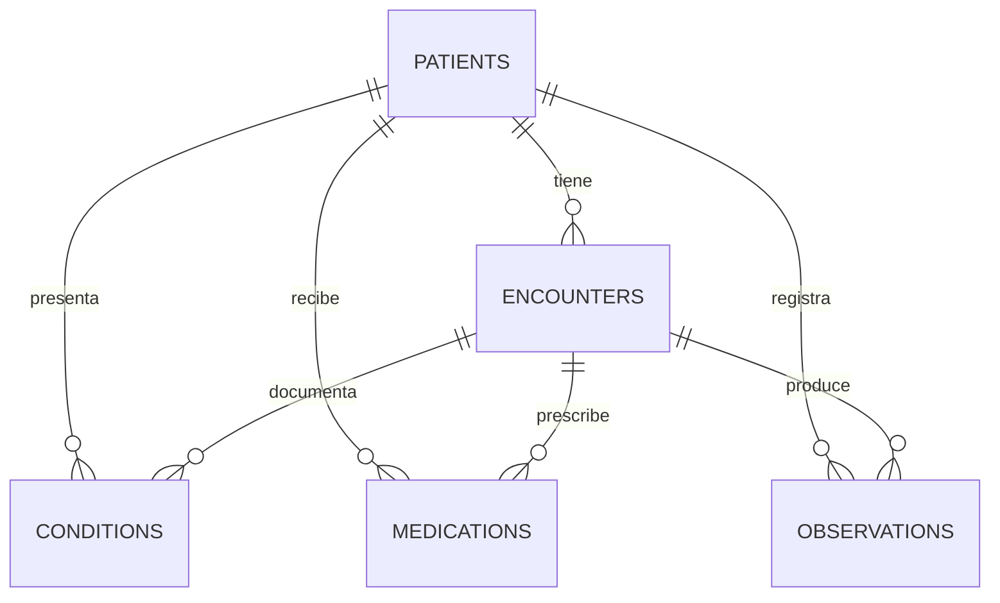

# Diagrama entidad-relación

## Llaves lógicas

| Tabla | Llave primaria lógica | Llaves foráneas |
|---|---|---|
| patients | patient_id | Ninguna |
| encounters | encounter_id | patient_id |
| conditions | patient_id + encounter_id + start_date + code | patient_id + encounter_id |
| medications | patient_id + encounter_id + start_time + code | patient_id + encounter_id |
| observations | patient_id + encounter_id + observation_time + code | patient_id + encounter_id |

`patient_id` conecta las cinco tablas. `encounter_id` relaciona los eventos
clínicos con el encuentro donde fueron registrados.

Estas llaves son lógicas: la carga analítica en DuckDB no impone
restricciones físicas.
