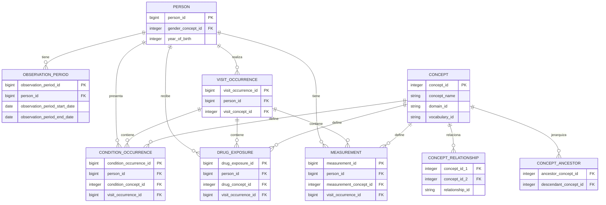

# Diagrama entidad-relación

## Comparación con OMOP CDM 5.4

1. El esquema conserva las columnas de OMOP 5.4, pero sólo se poblaron las
   tablas y dominios necesarios. Es una simplificación legítima del ETL.
2. Los `*_datetime` afectados quedaron nulos porque Synthea aporta fechas sin
   hora verificable y DuckDB presentó una incompatibilidad de conversión. Los
   `*_date` permanecen disponibles y no se inventaron horas inexistentes.
