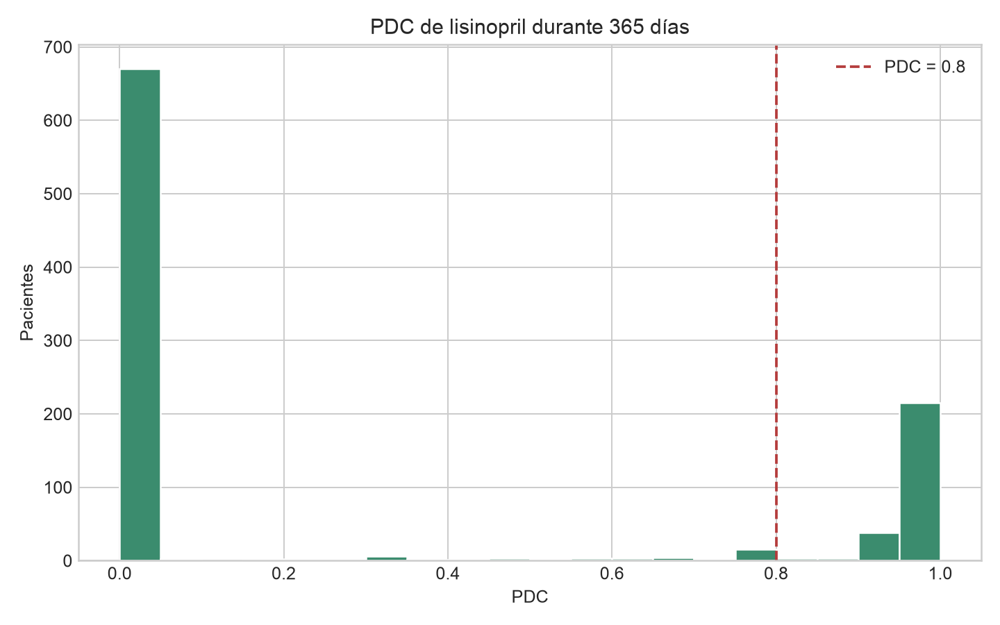
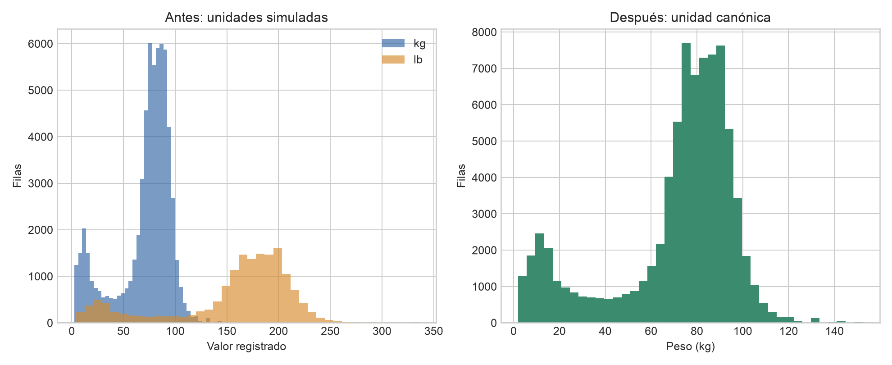
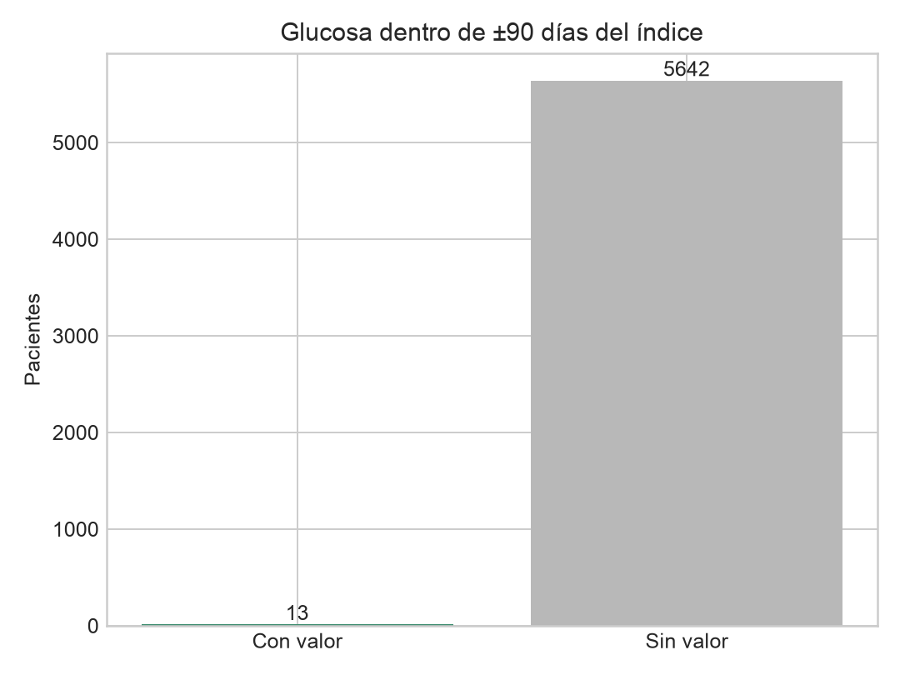

# Reporte de calidad — Laboratorio 13

## 1. Tipo de exposición

| drug_type_concept_id | drug_type_concept_name | exposiciones | personas | porcentaje |
| --- | --- | --- | --- | --- |
| 32838 | EHR prescription | 280617 | 5461 | 100.0 |

La base contiene **prescripciones registradas en el EHR**. Una prescripción indica
intención de tratamiento, pero no demuestra dispensación, disponibilidad física ni
consumo. Por ello, las métricas de cobertura describen cobertura prescrita estimada y
no adherencia observada.

## 2. Calidad de `DRUG_EXPOSURE`

| exposiciones | personas | porcentaje_end_date_nulo | porcentaje_misma_fecha | porcentaje_concept_id_cero |
| --- | --- | --- | --- | --- |
| 280617 | 5461 | 0.0 | 36.4311 | 0.0 |

| exposiciones | days_supply_no_nulos | minimo | q1 | mediana | q3 | maximo | no_positivos | mayores_365 |
| --- | --- | --- | --- | --- | --- | --- | --- | --- |
| 280617 | 280617 | -6 | 0.0 | 7.0 | 63.0 | 23499 | 102568 | 36355 |

El porcentaje de fechas finales nulas fue **0.0%**
y **36.4311%** de las exposiciones terminaron el mismo
día que comenzaron. Además, `days_supply` contiene valores no positivos y valores
superiores a un año. La base permite estudiar exposición prescrita si se aplican reglas
explícitas de limpieza, pero no permite inferir directamente consumo o dispensación.

### Ingredientes más frecuentes

| ingredient_concept_id | ingredient_name | exposiciones | personas | productos_descendientes |
| --- | --- | --- | --- | --- |
| 1125315 | acetaminophen | 20054 | 3569 | 11 |
| 1713332 | amoxicillin | 2006 | 1624 | 5 |
| 1177480 | ibuprofen | 5114 | 1447 | 3 |
| 1115008 | naproxen | 1307 | 1222 | 2 |
| 1539403 | simvastatin | 6355 | 1203 | 4 |
| 1759842 | clavulanate | 1363 | 1195 | 3 |
| 1549786 | ethinyl estradiol | 2285 | 1045 | 8 |
| 1308216 | lisinopril | 26195 | 1024 | 8 |
| 1361711 | nitroglycerin | 1038 | 992 | 2 |
| 1307046 | metoprolol | 1035 | 954 | 10 |
| 1589505 | levonorgestrel | 1511 | 906 | 6 |
| 19127890 | inert ingredients | 1837 | 882 | 6 |
| 1322184 | clopidogrel | 824 | 806 | 2 |
| 974166 | hydrochlorothiazide | 19656 | 757 | 15 |
| 1332418 | amlodipine | 18253 | 723 | 7 |
| 1521369 | norethindrone | 1485 | 701 | 5 |
| 1729720 | penicillin V | 756 | 675 | 2 |
| 1174888 | hydrocodone | 6205 | 668 | 4 |
| 1119510 | dextromethorphan | 700 | 667 | 1 |
| 738818 | doxylamine | 700 | 667 | 1 |

## 3. Ingrediente exacto frente a jerarquía

| ingredient_concept_id | ingredient_name | exposiciones_directas | personas_directas | exposiciones_jerarquia | personas_jerarquia | productos_descendientes | diferencia_personas |
| --- | --- | --- | --- | --- | --- | --- | --- |
| 1308216 | lisinopril | 0 | 0 | 26195 | 1024 | 8 | 1024 |

El concepto exacto de ingrediente de lisinopril recuperó
**0 pacientes**, mientras que la expansión con
`CONCEPT_ANCESTOR` recuperó **1024**. La diferencia se
debe a que `DRUG_EXPOSURE` almacena productos clínicos o de marca; el ingrediente actúa
como ancestro de esos productos y no necesariamente aparece como exposición directa.

## 4. `DRUG_ERA` construida manualmente

| eras_manuales | personas | fecha_minima | fecha_maxima | mediana_dias | maximo_dias | eras_cdm |
| --- | --- | --- | --- | --- | --- | --- |
| 6028 | 1024 | 1958-03-18 00:00:00 | 2026-11-02 00:00:00 | 1.0 | 3977 | 0 |

Se generaron **6028 eras** de lisinopril con un gap permisible de
30 días. La tabla `cdm.drug_era` contiene **0 filas**, por lo que no
fue posible comparar fechas era por era con una derivación previa. Las eras se dejaron
en `results.drug_era_lisinopril`.

Para controlar valores anómalos, se aceptó `days_supply` entre 1 y 365 días. Cuando no
cumplió esa condición, se usó la fecha final sólo si estaba entre 0 y 364 días después
del inicio; en otro caso se asignó un día de cobertura.

## 5. Proporción de días cubiertos

| pacientes_elegibles | minimo | q1 | mediana | q3 | maximo | pacientes_pdc_080 | porcentaje_pdc_080 |
| --- | --- | --- | --- | --- | --- | --- | --- |
| 975 | 0.00274 | 0.00274 | 0.00274 | 0.936986 | 1.0 | 259 | 26.5641 |

Entre los pacientes con 365 días completos de observación después de su primera
prescripción, **26.5641%** presentó PDC ≥ 0.8.

La PDC cuenta como máximo una cobertura por día, por lo que los intervalos solapados se
fusionaron y el resultado quedó limitado a 1. La MPR, en cambio, suele sumar el suministro
obtenido y puede superar 1 cuando hay surtidos solapados. Se eligió PDC porque evita doble
conteo y es la metodología utilizada por PQA para terapias crónicas. Fuentes:
[PQA](https://www.pqa.org/measures/measures-resources/) y [Hess et al./revisión metodológica](https://pmc.ncbi.nlm.nih.gov/articles/PMC7886011/).

Esta estimación supone que la prescripción representa disponibilidad, que la dosis se
mantiene constante y que el paciente permanece bajo observación durante todo el año.

## 6. Calidad de `MEASUREMENT`

| mediciones | personas | porcentaje_value_number_nulo | porcentaje_operador_no_cero | porcentaje_concept_id_cero |
| --- | --- | --- | --- | --- |
| 3111032 | 5744 | 22.1704 | 0.0 | 0.0 |

El **22.1704%** de las mediciones no tiene
`value_as_number`. No se detectaron operadores no cero, por lo que esta base no registra
explícitamente resultados censurados como `<5` o `>200`. En una fuente real se conservaría
el operador y se aplicaría un método analítico preespecificado; no se sustituiría
silenciosamente por el límite.

### Analitos más frecuentes

| measurement_concept_id | measurement_concept_name | mediciones | personas | unidades |
| --- | --- | --- | --- | --- |
| 43055141 | Pain severity - 0-10 verbal numeric rating [Score] - Reported | 146582 | 5744 | 1 |
| 4064377 | Depression screening | 96818 | 4991 | 1 |
| 3012888 | Diastolic blood pressure | 84762 | 5744 | 1 |
| 3004249 | Systolic blood pressure | 84762 | 5744 | 1 |
| 3025315 | Body weight | 80158 | 5744 | 1 |
| 3024171 | Respiratory rate | 77948 | 5744 | 1 |
| 3027018 | Heart rate | 77948 | 5744 | 1 |
| 3036277 | Body height | 76432 | 5744 | 1 |
| 3038553 | Body mass index (BMI) [Ratio] | 71043 | 5593 | 1 |
| 46236952 | Glomerular filtration rate [Volume Rate/Area] in Serum, Plasma or Blood by Creatinine-based formula (MDRD)/1.73 sq M | 63562 | 1680 | 2 |
| 44786664 | Weight difference [Mass difference] --pre dialysis - post dialysis | 62033 | 204 | 1 |
| 3004295 | Urea nitrogen [Mass/volume] in Blood | 53214 | 2650 | 1 |
| 3018572 | Chloride [Moles/volume] in Blood | 53214 | 2650 | 1 |
| 3032503 | Calcium [Mass/volume] in Blood | 53214 | 2650 | 1 |
| 3000483 | Glucose [Mass/volume] in Blood | 53214 | 2650 | 1 |

### Unidades observadas en eGFR

| measurement_concept_id | measurement_concept_name | unit_concept_id | unit_concept_name | unit_source_value | mediciones | personas | minimo | mediana | maximo |
| --- | --- | --- | --- | --- | --- | --- | --- | --- | --- |
| 46236952 | Glomerular filtration rate [Volume Rate/Area] in Serum, Plasma or Blood by Creatinine-based formula (MDRD)/1.73 sq M | 0 | No matching concept | mL/min/{1.73_m2} | 43690 | 877 | 1.0 | 53.0 | 161.0 |
| 46236952 | Glomerular filtration rate [Volume Rate/Area] in Serum, Plasma or Blood by Creatinine-based formula (MDRD)/1.73 sq M | 8795 | milliliter per minute | mL/min | 19872 | 1266 | 3.1 | 21.3 | 160.9 |

Las unidades `mL/min/{1.73_m2}` y `mL/min` no deben tratarse automáticamente como
equivalentes: una está indexada por superficie corporal y la otra no. Convertirlas de
forma segura requeriría superficie corporal o confirmar un error de mapeo.

## 7. Normalización de unidades

Como la base contiene peso únicamente en kilogramos, se simuló que una quinta parte de
las filas había llegado en libras. Se conservaron valor y unidad originales simulados y
se normalizaron **16094 filas** a kilogramos mediante:

`kg = lb × 0.45359237`

El factor proviene del [NIST Handbook 44](https://nvlpubs.nist.gov/nistpubs/hb/2026/NIST.HB.44-2026.pdf).

| unidad_antes | filas | minimo_antes | mediana_antes | maximo_antes | unidad_despues | minimo_despues | mediana_despues | maximo_despues |
| --- | --- | --- | --- | --- | --- | --- | --- | --- |
| kg | 64064 | 2.5 | 78.1 | 152.3 | kg | 2.5 | 78.1 | 152.3 |
| lb | 16094 | 4.409245243697551 | 172.84241355294404 | 335.5435630453836 | kg | 2.0 | 78.4 | 152.2 |

## 8. Valores implausibles

Los criterios se aplicaron sólo a mediciones de adultos para no clasificar pesos
pediátricos válidos como errores.

| concept_id | analito | poblacion | limite_inferior | limite_superior | unidad | fuente |
| --- | --- | --- | --- | --- | --- | --- |
| 3004249 | Systolic blood pressure | Adultos (>=18 años) | 40.0 | 250.0 | mmHg | https://doi.org/10.1155/2016/4364761 |
| 3000483 | Glucose [Mass/volume] in Blood | Adultos (>=18 años) | 10.0 | 500.0 | mg/dL | https://doi.org/10.1155/2016/4364761 |
| 3025315 | Body weight | Adultos (>=18 años) | 27.215542 | 317.514659 | kg | https://doi.org/10.1155/2016/4364761 |

| concept_id | concept_name | unit | lower_limit | upper_limit | adult_measurements | outside_range | outside_percentage | repeated_implausible_rows | repeated_implausible_values |
| --- | --- | --- | --- | --- | --- | --- | --- | --- | --- |
| 3000483 | Glucose [Mass/volume] in Blood | mg/dL | 10.0 | 500.0 | 52800 | 0 | 0.0 | 0 | 0 |
| 3004249 | Systolic blood pressure | mmHg | 40.0 | 250.0 | 66917 | 3 | 0.0045 | 0 | 0 |
| 3025315 | Body weight | kg | 27.2155422 | 317.514659 | 62362 | 0 | 0.0 | 0 | 0 |

Los intervalos proceden de Thomas, Paulet y Rajpura (2016),
[_Consistency between Self-Reported and Recorded Values for Clinical Measures_](https://doi.org/10.1155/2016/4364761).
Los valores fuera del intervalo se marcan y se convierten a nulo únicamente en una vista
analítica; el dato OMOP original se conserva. Una repetición exacta dentro del intervalo
no se considera centinela. Sólo una repetición exacta fuera del intervalo, o un código
documentado por el proveedor, se clasificaría como posible centinela.

## 9. `MEASUREMENT` frente a `OBSERVATION`

| clinical_fact | omop_table | concept_id | concept_name | events | persons | themis_assessment |
| --- | --- | --- | --- | --- | --- | --- |
| Body weight | MEASUREMENT | 3025315 | Body weight | 80158 | 5744 | Concordant: quantitative standardized measurement |
| Tobacco smoking status | OBSERVATION | 43054909 | Tobacco smoking status | 76111 | 5744 | Concordant: social and lifestyle fact |
| Systolic blood pressure | MEASUREMENT | 3004249 | Systolic blood pressure | 84762 | 5744 | Concordant: quantitative standardized measurement |

La ubicación coincide con las convenciones de [OMOP CDM v5.4](https://ohdsi.github.io/CommonDataModel/cdm54.html): peso y
presión arterial requieren una medición estandarizada, mientras que tabaquismo es un
hecho social o de estilo de vida y pertenece a `OBSERVATION`.

## 10. Valor más cercano a la fecha índice

La fecha índice se definió como la primera `condition_occurrence` de cada paciente. Se
seleccionó la glucosa con menor distancia absoluta dentro de ±90 días; ante empate se
prefirió el valor anterior al índice.

| personas_con_indice | personas_con_glucosa_basal | personas_sin_glucosa_basal | porcentaje_con_glucosa_basal |
| --- | --- | --- | --- |
| 5655 | 13 | 5642 | 0.2299 |

Hubo valor basal para **13 pacientes** y no lo
hubo para **5642**. La disponibilidad fue
**0.2299%**, por lo que exigir glucosa basal como
criterio de inclusión reduciría sustancialmente la cohorte.

## Limitación principal

La limitación principal es que `DRUG_EXPOSURE` representa prescripciones de EHR y no
dispensaciones ni administraciones. Además, `days_supply` presenta valores inválidos y
extremos. En consecuencia, las eras y la PDC deben interpretarse como reconstrucciones
de cobertura prescrita bajo supuestos, no como evidencia de que el paciente obtuvo o
consumió el medicamento.
