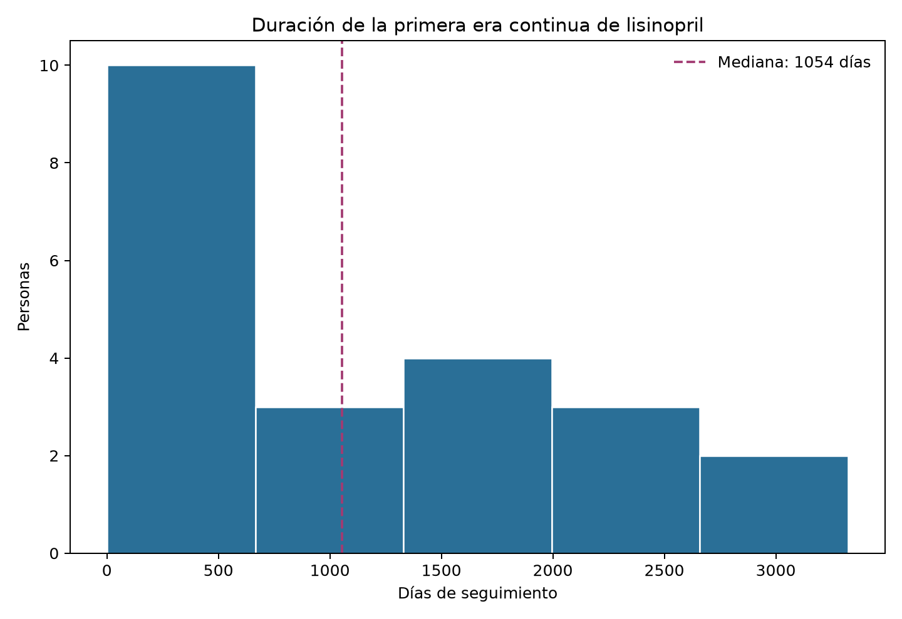
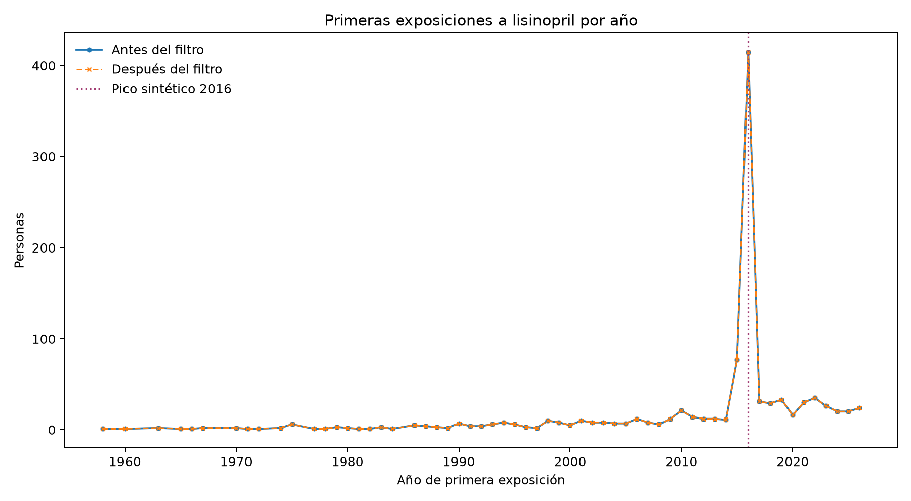

# Caracterización de la cohorte

## Tabla 1

| characteristic | value |
| --- | --- |
| Personas, n | 22 |
| Edad en índice, media (DE) | 56.8 (14.9) |
| Edad en índice, mediana [Q1–Q3] | 57.5 [46.0–69.2] |
| Seguimiento, mediana [Q1–Q3], días | 1054.0 [294.2–1766.0] |
| Sexo: Unknown, n (%) | 22 (100.0) |

## Diez comorbilidades más frecuentes en `[-365,0]`

| concept_id | concept_name | patients | percentage |
| --- | --- | --- | --- |
| 320128 | Essential hypertension | 19 | 86.36 |
| 4120314 | Hypertriglyceridemia | 11 | 50.0 |
| 436940 | Metabolic syndrome X | 7 | 31.82 |
| 201826 | Type 2 diabetes mellitus | 6 | 27.27 |
| 4214376 | Hyperglycemia | 4 | 18.18 |
| 4281516 | Gingivitis | 4 | 18.18 |
| 4172829 | Limited social contact | 3 | 13.64 |
| 4309238 | Social isolation | 3 | 13.64 |
| 439777 | Anemia | 2 | 9.09 |
| 4296653 | Acute ST segment elevation myocardial infarction | 2 | 9.09 |

## Seguimiento

| n | min_days | q1_days | median_days | q3_days | max_days |
| --- | --- | --- | --- | --- | --- |
| 22 | 1 | 294.25 | 1054.0 | 1766.0 | 3324 |

## Primeras exposiciones por año

Las curvas antes y después de exigir 365 días se superponen porque todos los
nuevos usuarios ya contaban con ese tiempo previo. El pico de 2016 permanece y
debe interpretarse como un artefacto del escenario sintético, no como un aumento
epidemiológico real.

## Revisión de immortal time bias

No se utilizó información posterior a la fecha índice para decidir la entrada ni
para clasificar la exposición inicial. T2DM, presión arterial, edad y embarazo se
evalúan en o antes del índice. Las exposiciones posteriores solo determinan el
fin de seguimiento mediante la era continua; por tanto, no crean tiempo inmortal
para la inclusión. El resultado no cambió tras la revisión porque no se detectó
ningún criterio postíndice que requiriera corrección.
