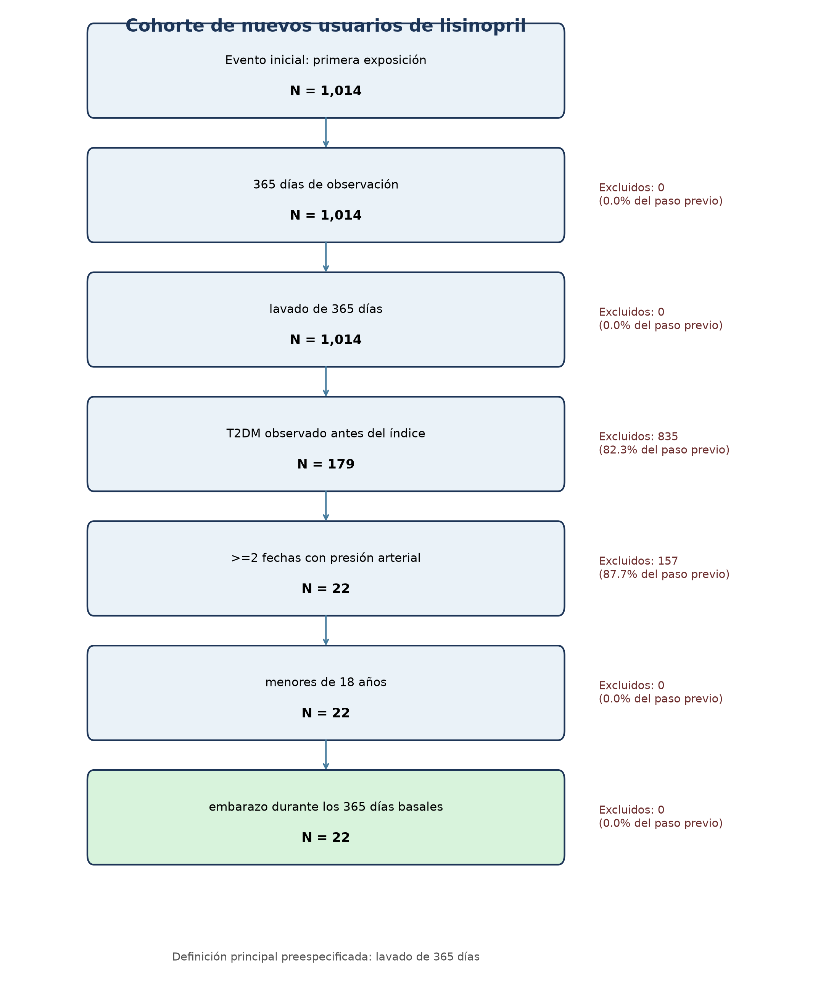
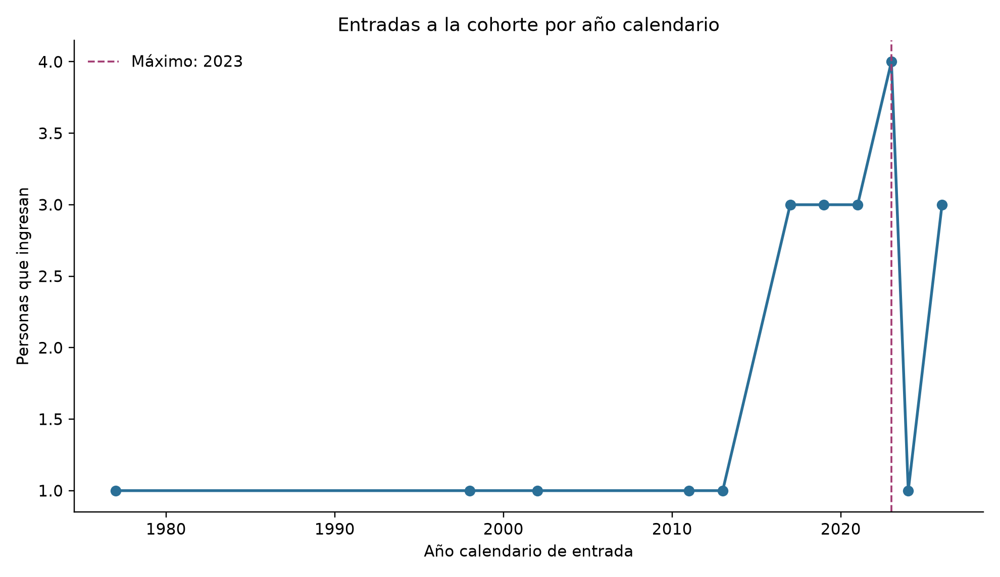
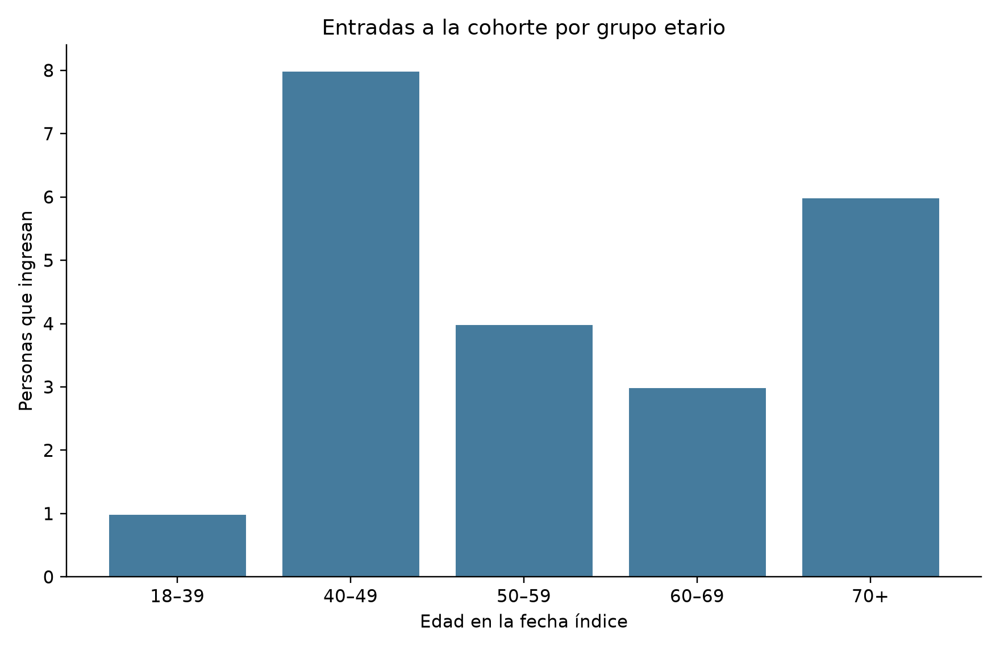
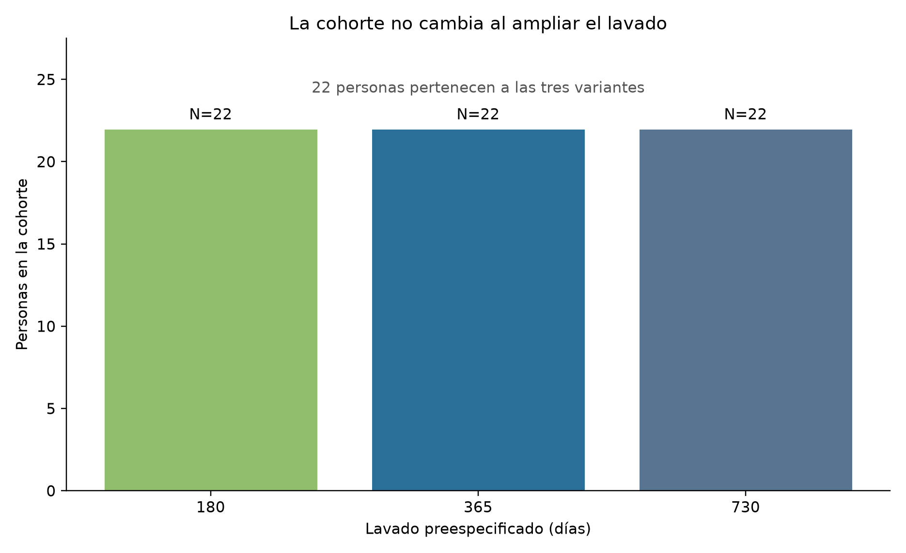

# Diagnóstico de la cohorte

## 1. Factibilidad a posteriori

| cohort_patients | followup_median_days | followup_q1_days | followup_q3_days | egfr_measurements | patients_with_egfr | egfr_below_60_events | patients_with_egfr_below_60 | model_feasible | reason |
| --- | --- | --- | --- | --- | --- | --- | --- | --- | --- |
| 22 | 1054.0 | 294.25 | 1766.0 | 255 | 19 | 65 | 6 | No | Sólo 6 pacientes presentan la señal renal; las 65 mediciones repetidas no son eventos independientes. |

La cohorte contiene **22 personas** y tiene un seguimiento
mediano de **1054 días**
`[294.25–1766.00]`. Durante ese
seguimiento se registraron **255 mediciones de eGFR** en
**19 personas**. Hubo **65
mediciones por debajo de 60, pero pertenecieron a sólo
**6 pacientes**.

**Veredicto:** la base no es factible para ajustar un modelo multivariable de
riesgo renal. Las 65 mediciones son repetidas y correlacionadas dentro de seis
personas; no equivalen a 65 desenlaces independientes. La cohorte sí sirve para
un análisis descriptivo y para demostrar el diseño. Para responder una pregunta
etiológica se necesita una fuente mayor, un comparador activo y más pacientes
con desenlaces renales observables.

### Unidades del desenlace

| unit_concept_id | unit_concept_name | unit_source_value | measurements | patients | minimum | median | maximum |
| --- | --- | --- | --- | --- | --- | --- | --- |
| 0 | No matching concept | mL/min/{1.73_m2} | 235 | 17 | 15.7 | 82.2 | 159.8 |
| 8795 | milliliter per minute | mL/min | 20 | 6 | 5.7 | 24.0 | 148.7 |

La coexistencia de dos representaciones de unidad se conserva como limitación.
No se mezclan como si fueran unidades distintas de un mismo valor sin revisar su
semántica y procedencia.

## 2. Atrición en el orden declarado

| step | criterion | n | lost_at_step | percent_initial_remaining | percent_lost_at_step |
| --- | --- | --- | --- | --- | --- |
| 1 | Evento inicial: primera exposición | 1014 | 0 | 100.0 |  |
| 2 | + 365 días de observación | 1014 | 0 | 100.0 | 0.0 |
| 3 | + lavado de 365 días | 1014 | 0 | 100.0 | 0.0 |
| 4 | + T2DM observado antes del índice | 179 | 835 | 17.65 | 82.35 |
| 5 | + >=2 fechas con presión arterial | 22 | 157 | 2.17 | 87.71 |
| 6 | - menores de 18 años | 22 | 0 | 2.17 | 0.0 |
| 7 | - embarazo durante los 365 días basales | 22 | 0 | 2.17 | 0.0 |

La mayor pérdida absoluta se atribuye a T2DM: 835 personas. El criterio de dos
fechas de presión elimina 157 de las 179 restantes y es el más exigente en
términos proporcionales. Ambos precios son coherentes con la pregunta, pero dejan
una cohorte demasiado pequeña para modelado.

## 3. El orden de los criterios

### Orden original

| step | criterion | n | lost_at_step |
| --- | --- | --- | --- |
| 1 | Evento inicial: primera exposición | 1014 | 0 |
| 2 | + 365 días de observación | 1014 | 0 |
| 3 | + lavado de 365 días | 1014 | 0 |
| 4 | + T2DM observado antes del índice | 179 | 835 |
| 5 | + >=2 fechas con presión arterial | 22 | 157 |
| 6 | - menores de 18 años | 22 | 0 |
| 7 | - embarazo durante los 365 días basales | 22 | 0 |

### Presión arterial antes de T2DM

| step | criterion | n | lost_at_step |
| --- | --- | --- | --- |
| 1 | Evento inicial | 1014 | 0 |
| 2 | + 365 días observación | 1014 | 0 |
| 3 | + lavado 365 días | 1014 | 0 |
| 4 | + >=2 fechas de presión | 88 | 926 |
| 5 | + T2DM antes del índice | 22 | 66 |
| 6 | - menores de 18 años | 22 | 0 |
| 7 | - embarazo basal | 22 | 0 |

El N final permanece en **22**. Sin embargo, al evaluar
primero la presión arterial, ese criterio parece costar 926 personas y T2DM sólo
66. La atrición describe el costo condicional en un orden declarado; no estima
un efecto intrínseco e independiente de cada regla.

## 4. Entradas por año y edad

El máximo anual ocurrió en **2023**, con
**4 entradas**, y el grupo etario más numeroso fue
**40–49** con **8 personas**. Estos son
conteos de entrada, no tasas de incidencia con persona-tiempo. Con sólo 22 casos,
los picos y caídas se interpretan principalmente como propiedades de la captura
sintética, la cobertura temporal y el pequeño denominador, no como cambios en la
enfermedad.

## 5. Códigos que produjeron el evento índice

| drug_concept_id | concept_name | concept_class_id | patients | percentage | patients_with_multiple_index_rows |
| --- | --- | --- | --- | --- | --- |
| 19080128 | lisinopril 10 MG Oral Tablet | Clinical Drug | 19 | 86.36 | 1.0 |
| 1308250 | lisinopril 2.5 MG Oral Tablet | Clinical Drug | 1 | 4.55 | 0.0 |
| 1308251 | lisinopril 5 MG Oral Tablet | Clinical Drug | 1 | 4.55 | 0.0 |
| 19080129 | lisinopril 20 MG Oral Tablet | Clinical Drug | 1 | 4.55 | 0.0 |

El producto **lisinopril 10 MG Oral Tablet** explica **86.36%**
de las entradas. En la práctica, la cohorte está dominada por esa presentación;
las otras dosis demuestran que la jerarquía evita reducir la definición a un ID
pegado a mano.

## 6. Conceptos huérfanos

| concept_id | concept_name | concept_class_id | exposures | patients | candidate_reason | include | decision |
| --- | --- | --- | --- | --- | --- | --- | --- |
| 974199 | hydrochlorothiazide 12.5 MG / lisinopril 10 MG Oral Tablet | Clinical Drug | 6 | 6 | Descendiente de HCTZ: exclusión deliberada | No | Excluir: contiene HCTZ y cambia la exposición de monoterapia preespecificada; no es un olvido del concept set. |
| 974201 | hydrochlorothiazide 25 MG / lisinopril 20 MG Oral Tablet | Clinical Drug | 6 | 6 | Descendiente de HCTZ: exclusión deliberada | No | Excluir: contiene HCTZ y cambia la exposición de monoterapia preespecificada; no es un olvido del concept set. |
| 974200 | hydrochlorothiazide 12.5 MG / lisinopril 20 MG Oral Tablet | Clinical Drug | 5 | 5 | Descendiente de HCTZ: exclusión deliberada | No | Excluir: contiene HCTZ y cambia la exposición de monoterapia preespecificada; no es un olvido del concept set. |

Los tres candidatos son reales y frecuentes en la base, pero son combinaciones
de lisinopril con HCTZ. Se mantienen fuera porque la definición principal busca
atribuir la exposición a lisinopril sin ese coprescriptor. Por tanto, son
huérfanos detectados por la búsqueda, pero no falsos negativos del concept set.

## 7. Comparación con ATLAS/CIRCE

| edge_case | circe_atlas_behavior | own_sql | importance_here |
| --- | --- | --- | --- |
| Identidad y orden de eventos del mismo día | Conserva eventos candidatos con identificador y ordinal antes de seleccionar el evento calificante. | Reduce directamente a MIN(fecha); un paciente tuvo más de una fila índice en el mismo día. | No cambia la fecha ni N, pero vuelve ambigua la presentación responsable; conviene deduplicar de forma determinista. |
| Múltiples periodos de observación | Evalúa cada evento dentro de un periodo continuo elegible y aplica los días previos/posteriores solicitados. | Hace un JOIN simple con OBSERVATION_PERIOD y supone un único periodo compatible por persona. | No afecta esta base porque hay un periodo por persona, pero sí limita la transportabilidad a datos asistenciales reales. |
| Colapso final de episodios | Puede colapsar intervalos solapados o próximos después de aplicar la estrategia de salida. | Conserva sólo el primer episodio por persona y no ejecuta una fase general de cohort collapse. | No cambia esta cohorte de primer episodio, pero sería esencial si se permitieran reingresos o episodios recurrentes. |

La comparación se basó en la estructura oficial de cohortes OHDSI y en el ejemplo
de nuevos usuarios de IECA. CIRCE convierte una expresión estructurada de cohorte
en SQL; no se copió su SQL generado.

Fuentes:

- [The Book of OHDSI — Defining Cohorts](https://ohdsi.github.io/TheBookOfOhdsi/Cohorts.html)
- [The Book of OHDSI — ACE inhibitors and new users](https://ohdsi.github.io/TheBookOfOhdsi/CohortDefinitions.html#b1-ace-inhibitors)
- [OHDSI CirceR](https://github.com/OHDSI/CirceR)

## 8. Sensibilidad al lavado

La definición principal sigue siendo **365 días**, declarada antes de comparar
los resultados. Las variantes de 180 y 730 días son análisis de sensibilidad.

| washout_days | patients | age_mean | age_median | followup_median_days | sex_categories | sex | top3_comorbidities |
| --- | --- | --- | --- | --- | --- | --- | --- |
| 180 | 22 | 56.8 | 57.5 | 1054.0 | 1 | Unknown: 22 (100.0%) | Essential hypertension (19); Hypertriglyceridemia (11); Metabolic syndrome X (7) |
| 365 | 22 | 56.8 | 57.5 | 1054.0 | 1 | Unknown: 22 (100.0%) | Essential hypertension (19); Hypertriglyceridemia (11); Metabolic syndrome X (7) |
| 730 | 22 | 56.8 | 57.5 | 1054.0 | 1 | Unknown: 22 (100.0%) | Essential hypertension (19); Hypertriglyceridemia (11); Metabolic syndrome X (7) |

### Tres comorbilidades más frecuentes

| washout_days | concept_id | concept_name | patients |
| --- | --- | --- | --- |
| 180 | 320128 | Essential hypertension | 19 |
| 180 | 4120314 | Hypertriglyceridemia | 11 |
| 180 | 436940 | Metabolic syndrome X | 7 |
| 365 | 320128 | Essential hypertension | 19 |
| 365 | 4120314 | Hypertriglyceridemia | 11 |
| 365 | 436940 | Metabolic syndrome X | 7 |
| 730 | 320128 | Essential hypertension | 19 |
| 730 | 4120314 | Hypertriglyceridemia | 11 |
| 730 | 436940 | Metabolic syndrome X | 7 |

### Traslape

| membership | patients |
| --- | --- |
| En las tres | 22 |
| Solo en 180 | 0 |
| En 180 y 365, no en 730 | 0 |
| Solo en 365 | 0 |
| Solo en 730 | 0 |

### Verificación de anidamiento

| check | passes | violations |
| --- | --- | --- |
| 365 subset 180 | True | 0 |
| 730 subset 365 | True | 0 |

Las tres variantes contienen exactamente las mismas 22 personas y cumplen
`730 ⊆ 365 ⊆ 180`. La ausencia de sensibilidad no prueba que la longitud del
lavado sea irrelevante en datos reales: surge porque el índice ya es la primera
exposición observada y Synthea proporciona periodos de observación casi
vitalicios.

## 9. Discusión final

La decisión que más afecta el tamaño no es el lavado, sino exigir T2DM previamente
observado y dos fechas basales de presión arterial. Se conserva como principal la
definición con lavado de 365 días porque equilibra la clasificación de nuevos
usuarios con una ventana basal clínicamente interpretable y fue declarada antes
de revisar las variantes. La limitación central es la combinación de una cohorte
final de 22 personas, sólo seis pacientes con eGFR bajo y sexo no mapeado para
todos los miembros. Antes de cualquier análisis causal también sería necesario
incorporar un comparador activo y verificar las unidades y la frecuencia de
medición renal. En consecuencia, este conjunto de datos permite auditar la
implementación, pero no sustenta conclusiones clínicas sobre el efecto renal de
lisinopril.
